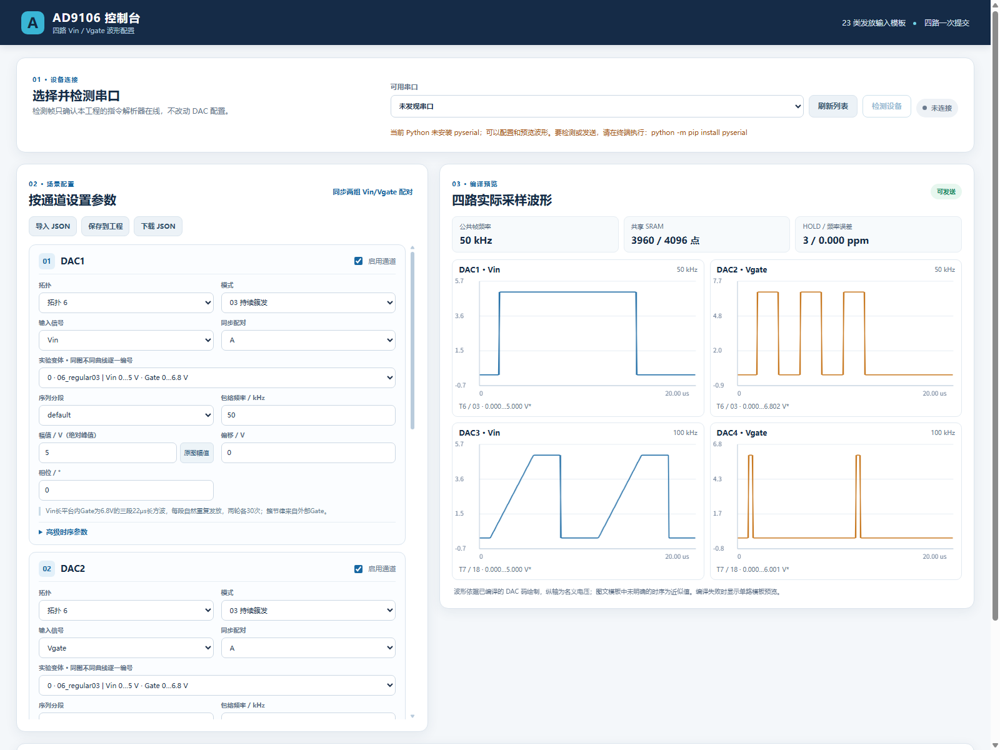

# 四路波形可视化控制台

双击 [start_firing_gui.cmd](../tools/start_firing_gui.cmd)，或在工程目录运行：

```powershell
.\.venv\Scripts\python.exe tools/firing_web.py
```

程序在本机启动服务并打开默认浏览器；命令行会打印实际地址，例如 `http://127.0.0.1:53324/`。保持命令行窗口运行，关闭窗口即停止服务。页面只绑定 `127.0.0.1`，不对局域网提供控制接口。要在不自动打开浏览器时启动：`python tools/firing_web.py --no-browser`。

波形配置和预览只依赖 Python 3.8 或以上版本的标准库及浏览器。**串口检测和发送**另需：

```powershell
.\.venv\Scripts\python.exe -m pip install pyserial
```

页面顶部每 6 秒刷新本机串口列表，也可点“刷新列表”。选择串口后点“检测设备”：程序发送一帧未知命令 `7F`，只有收到本项目解析器返回的 `03`（未知命令）、并通过序号和校验验证，才标记已连接；该探测不会产生 SPI 写入。切换串口后连接标记会清除，需要重新检测。没有连接标记时不能发送。

四张通道卡分别设置启用状态、拓扑、23 类模式、Vin/Vgate、实验变体、同一序列的分段、时长、幅值、电压偏移和时间偏移。“高级时序参数”可修改脉宽、间隔、上升沿、Gate 偏置及多档电压等。实验变体对应 HTML 中叠加绘制的各条不同实验曲线；`sequence/low/mid/high`、`near/far/single` 等序列分段由对应模式显示。整组时窗填写 **实际 μs**，含义是一次完整模板的持续时间（含模板前后空闲）；25 填写方波单周期时长（μs），26 填写正弦频率（kHz）。内部方波周期不等于整组时窗；幅值填写名义 **V 绝对峰值**，负向波形依原始方向缩放。“原图幅值”将该路幅值设为当前实验峰值与 10 V 中较小者。改变拓扑或模式会清除该路高级时序覆盖值。

发放模式在原通道卡上增加少量直接参数，不改变模式选择与发送流程：

- Vin、Vgate 的脉宽分别设置，只显示当前信号适用的字段。脉宽包含上升、下降沿；**新增字段填写实际 μs**，留空沿用原模板。03 的 Gate 脉冲组、20 的负 Vin 脉冲组同时支持 on 持续时间与间隔。
- 03、20、22 的“脉冲间隔”从前一脉冲完全回到基线算到下一脉冲开始；改变脉宽不改变所填间隔。03 另有 Vgate 脉冲数量，20 另有 Vin 脉冲数量。
- 05 的 Vgate、07 的 Vin 分别提供第一段电压、第二段电压、第一段持续时间、第二段持续时间。时间均为实际 μs，修改一段不会挤占另一段。保留原模板形状：05 拓扑 7 为两个方波平台，其他拓扑为从第一电压斜坡到第二电压后保持；07 从 0 V 斜坡到第一电压，再以第二电压保持。输入电压直接作为名义输出，幅值框停用，偏移仍叠加。
- 06 的 Vgate 开始电压、结束电压独立设置；Vgate 脉宽控制完整斜坡持续时间，均使用实际单位。
- 11 的 Vin 为方波脉冲列、Vgate 为连续正弦。Vin 方波单周期时长（μs）、占空比（%）、脉冲数量和 Vgate 正弦频率（kHz）独立设置；脉宽 = 单周期时长 × 占空比 / 100，基线间隔 = 单周期时长 − 脉宽。整组时窗容纳不下时，应增大时窗时长。
- 12 输出 **Vgate 恒压**；实验变体仅有“快脉冲”和“慢脉冲”，每次只输出选中的一组。Vin 同样设置内部方波单周期时长、占空比和脉冲数量，不再把两组拼在一个时窗。切换 11、12 的变体时，清除 Vin 单周期时长/占空比及旧脉宽、间隔覆盖，恢复所选变体的脉冲节律；脉冲数量和 Vgate 正弦频率保留。
- 23 显示为“兴奋性阻断”。
- 15 的三档 Gate 电压分别填写；21 的三档 Vin 电压也可分别填写。填写后这些值作为名义输出电压，幅值框停用，偏移仍会叠加；未填写的档位沿用原幅值下的模板电压。
- 配对联动模式、实验变体和序列分段；两路均为动态输出时，修改任一路整组时窗会同步到另一路。时间偏移、脉宽、间隔、电压、上升和下降时间分别设置，不互相复制。恒压通道没有时窗，不参与此联动。切换模式时两路恢复新模式的默认变体、分段、时序和幅值，Vin/Vgate 角色保留。
- 每条通道显示配对状态：同组恰好两条启用通道、分别为 Vin/Vgate，且拓扑和模式一致时，显示配对对象并启用模式联动；否则显示“当前未配对”，切换模式只修改当前通道。编译器检查配对的拓扑、模式、变体和分段一致性，再检查实际公共周期、存储和采样约束，不要求两路波形参数相同。

保存及下载的场景中，方波和整组时窗使用 `duration_us`、`vin_period_us`（μs）；模式 10/11 的 Vgate 正弦使用 `gate_frequency_khz`（kHz），标准正弦 26 使用 `frequency_hz`（界面以 kHz 输入）。已有正弦 `gate_period_us` 和模式 26 的 `duration_us` 会在导入时换算为频率；旧参考坐标 `gate_sine_period_us` 会结合时窗和模板长度换算。方波的旧频率仍换算为时间。后端继续兼容旧字段。配对动态通道的时窗在网页中联动，导入配置仍允许不同的时窗并检查公共周期；恒压通道没有时窗。

“本路上升时间 / 下降时间”使用 `rise_time_us` / `fall_time_us`，填写实际 μs；旧 `rise_us` / `fall_us` 导入页面时按原参考长度换算，旧 JSON 直接编译仍保留原坐标解释。显式设置的两段边沿之和超过脉宽时拒绝，不再自动裁短。两段斜坡模式仍通过对应的段时长调整斜坡。

其余原高级参数仍使用参考模板坐标，`parameters.period_us` 是参考模板长度（模式 24 除外），不能与通道实际 `duration_us` 混淆。旧 JSON 的 `width_us`、`levels_v` 等可继续载入，新增字段优先；模式 12 的旧分段在页面中改为当前快/慢变体选择，导入后请核对。11 的 Gate 统一正弦、12 拆组及恒压为实测协议修正。实测时序仍有 DAC 采样量化误差。

“理论波形 · 当前配置不可发送”说明四路联合编译失败：页面仅画出各路模板帮助检查，不能发送。上方会给出具体原因，例如配对变体或时序不一致、脉冲超出时窗、SRAM 容量或采样分辨率不足。修正后自动重新编译；显示“可发送”才是已通过编译的预览。

“同步两组 Vin/Vgate 配对”把 DAC1 的拓扑、模式、变体和分段复制给 DAC2，把 DAC3 的对应设置复制给 DAC4，并令每对信号分别为 Vin/Vgate。两路均为动态输出时也同步整组时窗；同模式且角色不变时，目标通道已有电压、边沿和时间偏移保留。切换模式或角色时恢复其波形参数初值。只选择单路时，配对设“无”。实际是否能够联合输出由页面实时编译决定；失败时显示理论预览并禁止发送。

页面右侧显示**真实编译后数字采样**对应的四路名义电压，还给出各路实际时窗 / 单周期时长、公共播放单元时长、共享 SRAM 已用点数、HOLD 和最大时长误差（μs）；模式 10/11 另显示 Vgate 实际正弦频率，26 显示实际 DDS 频率。细窄平台在图中使用每像素的最小/最大值绘制，避免窄脉冲在预览中消失。“下载 JSON”可在本机留存场景，“导入 JSON”可载入现有场景。“保存到工程”写入 `.uart_sim/firing_scene.json`，下次打开页面继续使用；发送前也会保存一次，并在 `.uart_sim/firing_web_plan/` 导出指令及四路 CSV。

模式 11 的默认对齐约定：两路时间偏移均为 0 时，Vgate 正弦最高点对齐 Vin 第一个方波的中心。编译器读取配对 Vin 的实际中心时刻，再独立应用各路 `time_offset_us`。正数使本路延后，负数使本路提前，数值按实际 μs 解释，不随时窗或频率变化而缩放。Vgate 仍在脉冲列之前和之后连续输出。

时间偏移是周期波形的循环平移，不是在开头插入空白，也不是延迟硬件触发。移出周期边界的部分会循环到另一侧。标准方波 25 也支持时间偏移，但所有通道合并后的电平切换仍须满足最小 300 μs 间隔；过密时拒绝发送。恒压没有时间偏移。当前末尾等待优化不用于非零循环偏移，因此长时窗设置偏移后可能需要更多 SRAM。

同频信号的附加相位差可以由偏移计算：令 `Δt = Vgate 时间偏移 − Vin 时间偏移`，则 Gate 相对默认对齐位置的相位变化为 `−360 × f_Hz × Δt_us / 1000000` 度。Δt 为正表示 Gate 滞后；例如 500 kHz 下延后 0.2 μs，表示滞后 36°。不同频率的信号没有固定的相位差。此计算描述相对默认波形关系的额外偏移；共振模式的默认基准仍是峰值对方波中心。

旧场景 `phase_deg` 仍可直接编译；网页导入时按 `time_offset_us = −phase_deg / 360 × 原时窗时长_us` 换算，标准正弦则用其周期作为时长。新导出只保存 `time_offset_us`。采样时钟及 DDS 寄存器会引入量化误差，预览显示编译后结果；这里的时间偏移不是外部电路传播延迟的校准。

资源分配不固定平分：恒压使用常数寄存器，占用 0 点；动态通道生成采样数组，完全相同的数组共享一段，否则分别分配。图下显示各路点数和共享对象，总计按去重后的点数计算。拓扑 6 常用的 01、02、07、09、12、19、20、21、22、23 模式的 Vgate 均为恒压，一路 Vin 可以使用超过 2048 点、最多 4096 点。动态 Vgate 不会为节省容量而自动改成恒压。

恒压通道显示恒定电压与偏移，隐藏时窗、时间偏移、序列分段及脉冲参数；保存时不再写入无意义的时序字段。旧恒压场景中残留的脉冲参数不影响直流输出。模式与实验选择仍保留，以便和 Vin 联动。

判断设置是否合适时，查看三个信息：

- **容量**：共享 SRAM 合计不能超过 4096 点；页面显示剩余点数。失败时，如存在可采样但超容量的方案，会给出检查过的方案中最少点数及各路占用，不代表所有可能硬件优化后的理论最优值。
- **时间细节**：SRAM 采样间隔为 `HOLD / DAC 时钟`，在当前 148.5 MHz 下约为 0.006734～0.107744 μs。完整时窗和末尾等待优化采用相同规则：不足一个采样间隔的平台或间隙拒绝发送，不自动补成一点；短边沿显示精度警告；动态信号采样后完全退化成恒压也拒绝。“可发送 · 请检查细节”表示通过容量和计时检查，但存在边沿精度警告。更长的边沿也不等于模拟输出已达到该精度，仍需实测。
- **整体时序**：公共播放时窗和最大整组时长误差。各通道需要共同可表示的播放周期；两路周期不匹配可能拉长公共时窗、增加点数。整组时长误差不是每一个边沿的误差。

编译器自动尝试 HOLD 1～16 和周期计时基数，按整组计时误差、HOLD、存储占用选择方案。完整时窗放不下时，只在可以证明末尾是 DAC 零码时尝试省略末尾等待段；内部间隙仍占点。用户无需手动分配地址：超容量通常应缩短有效波形或减少脉冲数量；采样不足则应检查过短边沿及两路时长的组合。不能靠单纯延长时窗解决存储不足。

确认预览无误后点“发送四路配置”。浏览器显示每帧回包进度，FPGA 收齐并提交后四路公共触发启动。点击“停止输出”会发送 `43` 指令，已运行的场景也可停止；清零的数字码与板级实际输出零伏之间仍需实测校准。如果上传失败，界面会清除已检测连接标记，应检查设备状态、刷新串口并重新检测。



该页面调用现有 [波形编译器及串口协议](FIRING_CONTROL.md)，没有增加 FPGA 顶层端口。默认电压换算是名义 ±10 V、12 位码；HTML 缺少原始 CSV，波形时序为图文模板。详见 [验证结果](FIRING_VERIFICATION.md)。
# 静态扫描与单次播放

模式“24 静态扫描”输出有限时长的单次脉冲。Vin 设置脉冲电压和持续时间（μs）；Vgate 设置包络电压、提前建立时间和延后归零时间（μs）。不再填写公共时窗或循环时间偏移。Vgate 提前升高，在 Vin 结束后继续保持一小段时间，最后也归零；总时长由这些参数自动确定。

点击“DAC3 Vin / DAC4 Vgate 静态扫描”建立初值：Vin 为 1 V、持续 2000 μs（2 ms）；Vgate 电压初始为 0 V，提前和延后各 300 μs，发送前按实验需要设定其电压。按钮同时关闭 DAC1/2。每次点击发送只触发一次，静态扫描的触发组数固定为 1。例：Gate 升高 → 300 μs → Vin 升高 → 2000 μs → Vin 归零 → 300 μs → Gate 归零。

长脉冲使用工程已有的 FPGA 定时事件功能，按时切换 DAC 常数寄存器与增益，不占 SRAM；下降沿不依赖电脑延时或串口发送时机。相邻独立切换至少相隔 300 μs，同时切换会合并；提前/延后可以设为 0。若间隔更短，软件尝试将整个有限包络编译为一次 SRAM 播放，无法保留细节时拒绝发送。因此 2 ms 脉冲不能搭配 10 μs 的独立提前/延后切换。事件模式的整个包络受现有 100 MHz、32 位计时器限制，约不超过 42.95 秒，软件会预留启动及提交时间。

此次只修改上位机，长脉冲要求板上已使用支持基本波形事件表的现有固件，参见 [基本波形固件说明](AD9106_BASIC_1KHZ.md)。结束事件明确清零四路常数及增益；“归零”指 DAC 数字零码，板级模拟零点和边沿精度仍以实测为准。界面等待包络结束后才解除发送忙状态，期间可以点击停止。

新网页保存 `static_pulse: true` 和 `repeat_count: 1`；Vin 参数为 `width_us`，Gate 为 `gate_lead_us`、`gate_tail_us`。静态扫描不能与其他模式同时启用。旧 JSON 直接交给命令行且不带 `static_pulse` 时仍按原模式 24 解释；经网页导入后改为新的单次包络，请核对电压和提前/延后时间。
