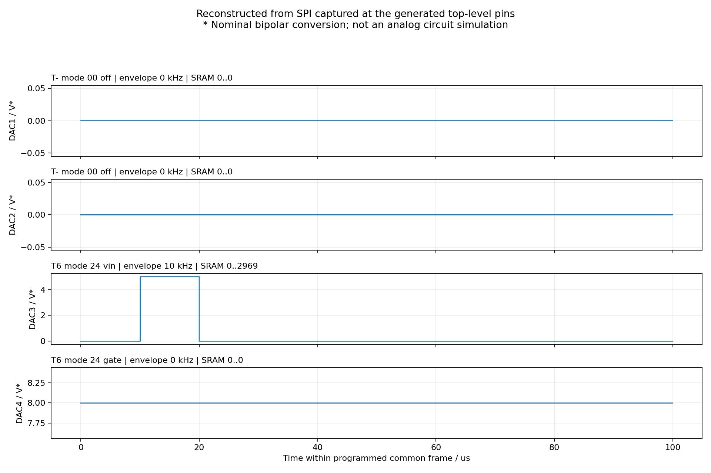

> 当前版本已按用户要求删除自动 RUN 清零、截止计时及 20 ms 等待。以下为历史排查记录；当前流程与验证要求见 [AD9106_SINGLE_PATTERN.md](AD9106_SINGLE_PATTERN.md)。

# 23 类 Vin/Vgate 功能验证

日期：2026-10-23。Vivado/XSim 2023.2，当前生成顶层 `design_1_wrapper`，器件 `xc7a35tfgg484-2`。本报告对应新增场景命令后的 RTL；旧 demo 历史报告另见 [PROJECT_VERIFICATION.md](PROJECT_VERIFICATION.md)。

当前数字控制逻辑通过下述检查，并已完成布局布线和 bitstream 生成。尚未做 AD9106 实物输出测量或板级模拟仿真，不能据此承诺实际电压精度或神经元发放结果。

## 通过的验证

| 检查 | 覆盖 | 结果 |
| --- | --- | --- |
| `tools/test_firing.py` | 92 组目录、163 个实验；504 种 Vin/Gate/分段选择逐个在 100 kHz 编译；负电压、多档电压、快慢斜坡、Gate 缺口、连续正弦、通道任意分配、配对一致性、容量/电压拒绝、窄事件冲突、指令校验和寄存器映射 | 11 项测试通过 |
| `test_firing_uart.ps1` | 加速模块级串口 RX→parser→SPI→TX；完整四路上传 | 590 帧、4008 次 SPI 写入逐项一致 |
| `test_firing_uart.ps1 -Top` | 当前生成 BD、顶层和模块 wrapper；正式 100 MHz、115200 baud、1 MHz SPI、20 ms 停止等待、1 us 更新等待 | 同样完整通过；仿真时间 1.976871010556 s |
| `tools/analyze_firing_sim.py` | 读取实际顶层 SPI 监视器导出的 SRAM/寄存器，对照 PC 计划；从捕获数据重建四路序列 | 所有编程寄存器、全部 3960 个已分配采样均一致 |
| `test_uart_control.ps1` | 原始三指令、初始化、正负增益/偏移、方波边界、错误恢复 | 原模块回归通过 |
| `check_top_project.tcl` | 当前 RTL 和生成顶层的全新综合，无旧 checkpoint；读取实际 XDC、检查端口和内部时钟 | 综合完成，1209 LUT、623 FF，无 BRAM/DSP |
| `tools/test_firing_web.py` | 本地页面接口、四路实际采样预览、串口只读探测、模拟串口 590 帧上传及已提交场景的停止命令 | 3 项测试通过；浏览器页面实际渲染截图已检查 |

顶层场景测试为节省仿真运行时间，仅将 Clock Wizard 替换成 50→100 MHz 功能模型，**控制 RTL、生产参数、BD 和模块 wrapper 均为当前工程文件**。该模型不加入工程源或综合。真实厂商 MMCM 的锁定/复位验证记录见旧报告；本轮没有重新执行真实 MMCM 下的整套 23 类场景上传。

504 种选择的覆盖属于 PC 模板和编译器测试；不是 504 次芯片模拟输出验证。串口到 SPI 的完整顶层回归采用下面一个四路场景。SPI 监视器只检查数字写入及简单寄存器/SRAM状态，不是厂商芯片行为模型，也没有模拟输出滤波、放大器、负载或 SDO 读回确认。

## 实际顶层场景

场景文件：[example_two_pairs.json](../waveforms/example_two_pairs.json)。公共帧周期 20 us（50 kHz），HOLD=3，每路每帧 990 点，总 SRAM 3960/4096 点。DAC1/2 一帧一个包络，DAC3/4 一帧两个包络；最后一次 RAMUPDATE 和 trigger 为公共启动点，四路 START_DELAY 都为 0。

| 通道 | 输入 | 包络频率 | SRAM 地址 | 实际写入码范围 | 名义电压范围 |
| --- | --- | --- | --- | --- | --- |
| DAC1 | 拓扑 6 / 03 / Vin | 50 kHz | 0～989 | 0～1024 | 0～5.000 V |
| DAC2 | 拓扑 6 / 03 / Gate | 50 kHz | 990～1979 | 0～1393 | 0～6.802 V |
| DAC3 | 拓扑 7 / 18 慢上升 / Vin | 100 kHz | 1980～2969 | 0～1024 | 0～5.000 V |
| DAC4 | 拓扑 7 / 18 慢上升 / Gate | 100 kHz | 2970～3959 | 0～1229 | 0～6.001 V |

横轴为公共帧内部时间，不含芯片公共启动流水线延迟；纵轴采用假设的 ±10 V 换算。该图表示实际发出的数字样本对应的名义波形，不能替代示波器实测。

捕获证据：[仿真日志](firing_verification/firing_uart.log)、[SPI 事务](firing_verification/firing_spi.csv)、[独立分析结果](firing_verification/observed_summary.json)。[23 类模板总览](firing_verification/topology6_template_overview.png) 用于检查波形分类，绘制的是图文模板本身，与上述 SPI 捕获图分开标注。

## 状态与异常检查

完整串口用例还确认：8 位 SEQ 超过 255 后回绕；BEGIN/WRITE 的成功回复在 SPI 完成、trigger 高状态下返回；COMMIT/ABORT 成功回复在最终更新完成、trigger 低之后返回。上传前写块、重复 BEGIN、关闭会话后写块/提交、MEM_ACCESS 未关闭就提交、错误校验、数量超限、地址跨界、直接 RAMUPDATE/开启 RUN 都会被拒绝；被拒绝整块没有部分 SPI 写入。

首次 BEGIN 后旧固定布局指令被隔离，防止破坏场景 SRAM。ABORT 在上传中及场景提交后均可执行，检查了 RUN=0，四路数字增益、偏移和常数全部清零。BEGIN 也在上传前写零增益和偏移并更新，以覆盖原通道正在输出直流时的情况。

## 上板前仍需完成

全新综合后的建立时间估计 WNS 为 +2.814 ns；保持时间 WHS 为 −0.001 ns，报告仍显示 timing constraints are not met。当前为综合后估计，需完成布局布线后确认保持时间修复及完整时序收敛，不应把综合通过当作时序已满足。

实际 XDC 中 UART `uart_rx_0/uart_tx_0` 仍缺 PACKAGE_PIN 和 IOSTANDARD，产生 UCIO-1、NSTD-1；配置 Bank 的 CFGBVS/CONFIG_VOLTAGE 也未设置。缺少板级资料，未猜测管脚、未降低 DRC 严重级别。这些约束必须按实际板卡补齐才能正常生成可用 bitstream。新功能没有增加顶层端口，原模块连接继续使用。

综合报告保存在 `.uart_sim/top_synth/`，本轮副本位于 `firing_verification/synthesis/`。复现实验命令见 [FIRING_CONTROL.md](FIRING_CONTROL.md)。
## 2026-10-23 单次播放与静态扫描增量验证

`tools/test_firing.py` 验证静态扫描 Vin 单脉冲、Vgate 恒压、单次播放寄存器值以及 504 种原图模板组合；`tools/test_firing_web.py` 验证两次播放只上传一次完整配置，第二次使用 `44` 再次触发，且仍可发送停止命令。顶层 XSim 验证 `44` 先配置单次播放，再写 RUN=1，最后执行 RAMUPDATE 后触发一次，并在截止时自动写 RUN=0 和 RAMUPDATE；ABORT 后 `44` 被拒绝。AD9106 自身的模拟输出与后级 ±10 V 电路仍需板级示波器验证。

前一版仅在公共时窗结束后抬高 TRIGGER；板上实测芯片 Pin 32 的时序正确，但 Vin 仍以 100 µs 周期连续发放，证明该数字时序仿真不能替代芯片输出验证。现已将静态截止点改为最后一个非基线 Vin 样本之后：当前 DAC3 Vin 10–20 µs 脉冲约在 21.1 µs 截止，同时 FPGA 自动写 `PAT_STATUS.RUN=0` 并 RAMUPDATE。下一次 `44` 先配置单次播放，再写 RUN=1，最后执行 RAMUPDATE 后触发。1 MHz SPI 的第一条 RUN=0 写入约需 32 µs，故当前场景在下一个脉冲最早出现的约 110 µs 前已发出停止写入；其实际效果仍以板测为准；过宽或太靠后的静态脉冲被编译器拒绝。静态场景和四路场景的模块/顶层 XSim 均核对了自动停机与重触发顺序；`0x7FFE` 不进入 SPI。`tools/analyze_firing_sim.py` 还验证了静态场景中所有编程寄存器和 SRAM 内容。这些结果只验证数字控制路径；RUN=0 对板上模拟输出的实际效果仍需新 bitstream 烧录后测量。

此前 RUN 自动停机改动于 2026-10-23 02:37 生成过 bitstream。它已被下述芯片有限次模式版本覆盖；必须烧录最新文件才能验证本次修正。

早期版本在同日完成过一次综合实现，WNS 为 1.643 ns；当前 bitstream 的最新结果以本节前述 +1.752 ns 为准。UART RX/TX 在 XDC 中分别约束 A21/C20。工程无法从本机确认 bitstream 是否已下载到板卡。
## 2026-10-23 芯片有限次模式复核

对照 AD9106 Rev.C 数据手册，`0x1F[0]=1` 表示有限次，`0x2A/0x2B` 的每个 8 位字段为 `0` 表示各通道播放一次。以下为旧版记录（启动顺序有误，已由本次修正替代）：上电默认模式已由连续改为有限次；场景 COMMIT 和 UART `44` 再次触发均按 `RUN=0 → 0x1F=1 → 0x2A=0 → 0x2B=0 → RAMUPDATE=1 → RUN=1 → TRIGGER↓` 执行，RUN 是最后一笔 SPI 配置。顶层 XSim 的逐笔 SPI 比对及第二次触发顺序检查通过。构建时关闭 IP 缓存，重新综合 AD9106 与解析器检查点后，bitstream `AD9106_demo.runs/impl_1/design_1_wrapper.bit` 于 2026-10-23 14:02:55 生成；布线后 WNS +1.436 ns、WHS +0.121 ns，时序约束通过。读回芯片实际寄存器和板上模拟输出仍需实物复测。详见 [AD9106_SINGLE_PATTERN.md](AD9106_SINGLE_PATTERN.md)。

## RUN 与 RAMUPDATE 顺序修正（2026-10-23）

用户 SDO 回读为 1F=0001、2A/2B=0000、28=0515、29=3A02，仍有波形串。本次按手册第 31 页和 ADI 技术支持修正上电、COMMIT、RETRIGGER：RUN=1 → RAMUPDATE=1 → TRIGGER 下降。上述旧版反向顺序记录不再适用。

模块及完整 BD 顶层 XSim 通过；顶层检查 450 个 PC 帧和 3022 笔 SPI 写入。新增独立 SPI 顺序断言通过上电、首次发送、再次触发三个场景，日志包含 PASS START ORDER。18 项 Python 测试通过。仿真验证的是数字接口与规定启动顺序，尚不能证明板上 25 ms 波形串已消除。
