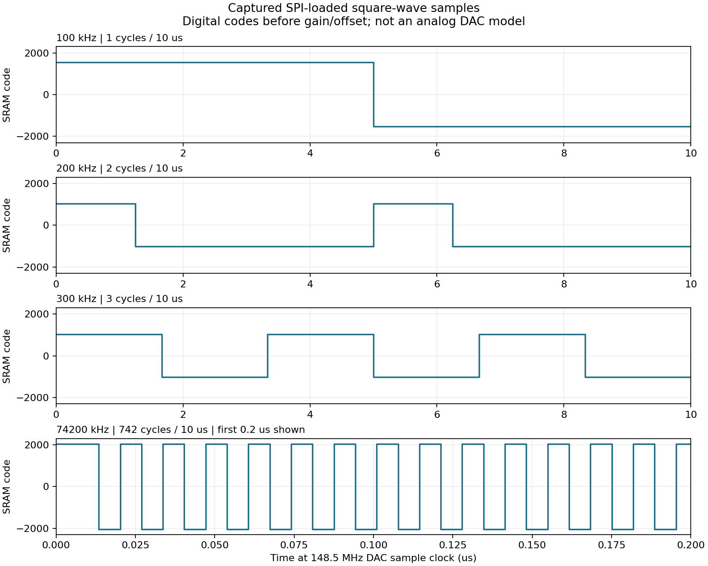

# 当前顶层项目验证报告

本报告保留 23 类激励功能加入前的 demo 验证记录。新增功能及当前 RTL 的回归、综合结果见 [FIRING_VERIFICATION.md](FIRING_VERIFICATION.md)，不要将下述旧结果作为新增功能的验证结论。

验证日期：2026-10-20。工具：Vivado / XSim 2023.2。顶层：`design_1_wrapper`。

## 结论

**当前 FPGA 控制逻辑、顶层握手连接及串口协议在本次仿真范围内通过验证；目前还不能直接认定项目可上板工作。** 串口 RX/TX 的管脚及 IO 电平约束尚未配置，布局布线后的时序也尚未验证。

本轮没有发现需要修改控制 RTL 或顶层连线的功能错误。修改了旧 `tb_ad9106.v`，将新增加的串口 RX 输入固定到空闲高电平，避免仿真端口悬空；增加了顶层 testbench、时钟专项 testbench、隔离运行脚本和证据导出脚本。

## 验证方法与范围

1. **模块级回归**：`tb_uart_control.sv`，验证接收、解析、SPI 写入和返回链路，含 5 MHz 方波、边界和错误恢复。该测试使用加速分频/等待参数。
2. **完整顶层功能回归**：`tb_top_uart.sv`，直接实例化当前生成的 `design_1_wrapper`、BD 和四个模块 wrapper，控制 RTL 使用生产参数：100 MHz、115200 baud、1 MHz SPI、20 ms 停止等待、100 ms 半帧超时。仅将厂商 MMCM 替换为 50→100 MHz 的功能时钟模型，以避免长时间运行厂商高频内部时钟模型。仿真经过 **706.662 ms**，完整通过 **15 次回包检查、2 次初始化检查**，捕获 **12022 笔完整 SPI 写入**。
3. **真实厂商 MMCM 专项**：`tb_clock_wizard.sv`，实际生成顶层、MMCM 和 BUFG 模型，验证锁定、100 MHz 输出、外部复位、重新锁定与顶层初始状态，测试完整结束并输出 PASS。
4. **真实厂商 MMCM 顶层长测的已完成用例**：额外跑通了初始化、正弦配置、三角配置与 100 kHz 方波配置。相关 PASS 日志保存在 `verification/vendor_top_prefix.txt`。之后主动停止了该慢速长测的剩余部分，**这份日志不代表厂商 MMCM 模型下的全套用例通过**；完整边界/恢复覆盖来自第 2 项。
5. **全新顶层综合**：直接读取当前生成文件和 RTL，重新综合顶层，没有复用工程里保存的旧 DCP。使用现有 XDC 做 IO 检查，并以 50 MHz 输入时钟检查内部时序估算。

SPI 监视器在实际顶层引脚上解码完整 32 位事务，检查地址/数据、1 MHz 时钟、SRAM 左对齐数据及 MEM_ACCESS/RUN 状态；再重建 SRAM，检查实际写入的采样序列。它不是 AD9106 厂商模型，也不模拟模拟输出电路、SPI SDO 回读或器件内部实际更新延迟。

## 各模块结果

| 模块/链路 | 验证内容 | 结果 |
| --- | --- | --- |
| Clock Wizard | 50 MHz 输入、100 MHz 输出、锁定、外部复位及重新锁定 | 通过厂商模型专项 |
| `uart_cmd_rx` | 实际 115200/8N1 字节接收；停止位错误/break 检测及恢复 | 通过 |
| `ad9106_cmd_parser` | 三种波形、正负增益/偏移、正弦相位、方波参数边界、校验/结束符/未知命令/超时/未初始化错误 | 通过 |
| `AD9106` 上电流程 | 3011 笔 SPI 写入、2970 个 SRAM 采样、周期 1485、两个通道的 SRAM 地址 | 通过，两次初始化均完成 |
| `ad9106_spi_writer` | MSB-first 32 位事务、1 MHz 时钟、数据对齐与写完成握手 | 通过 |
| `uart_cmd_tx` | 完整 8 字节回包、序号/命令/状态/XOR、停止位；成功回包晚于最终 cfg_done 和重新触发 | 通过 |
| DAC4 数据保护 | 初始化存储五次原 297 点波形；运行时三种命令不改 DAC4 SRAM/增益/偏移/地址及全局周期 | 通过 |
| 顶层复位恢复 | 方波 SRAM 写入过程中拉低外部 resetn，随后重新初始化，再发送正弦命令 | 功能时钟回归通过 |

正弦用例检查 DDS 字 `0x200000`（148.5 MHz 时钟下名义 18.5625 MHz）、相位 90°、增益 0.5、偏移代码 −128 的寄存器写入。三角用例检查步长 63、增益 −1、偏移代码 +128 的写入。关闭输出用例确认目标通道增益与偏移均写 0。

## 方波采样证据

下面的图由顶层 SPI 事务重建的 SRAM 数据生成，展示的是**数字采样代码**，位于增益、偏移和模拟输出电路之前，不能作为实际 DAC 输出电压波形。



| 名义频率 | 每 10 µs 周期数 | 实际采样占空比 | 用例说明 |
| --- | ---: | ---: | --- |
| 100 kHz | 1 | 50.0337% | HIGH=+1536、LOW=−1536，另检查增益 0.5 |
| 200 kHz | 2 | 24.9832% | DUTY=371，验证非 50% 占空比 |
| 300 kHz | 3 | 50.1010% | 错误帧后恢复，DUTY=743 的量化结果 |
| 74.2 MHz | 742 | 50.0337% | 多字节 RATE 与上限，HIGH=+2047、LOW=−2048 |

模块级回归另检查了 5 MHz、每帧 50 周期。上述频率基于板卡预期的 148.5 MHz DAC 时钟；本工程并不测量或产生这个外部 DAC 采样时钟。

## 延迟与错误处理

完整顶层功能回归中，从请求首位开始到返回最后停止位结束：

| 操作 | 仿真延迟 |
| --- | ---: |
| 正弦配置 | 约 23.031 ms |
| 三角配置 | 约 22.967 ms |
| 方波配置 | 约 70.578 ms |
| 一般错误帧返回 | 约 2.773 ms |
| 半帧超时返回（含此前收到的 4 字节） | 约 101.037 ms |

结束符、XOR、未知命令、越界参数、半帧超时、停止位错误分别得到状态 01～06；初始化期间返回 07。初始化完成后，这些错误用例没有增加 SPI 写入次数。PC 仍须遵守“一帧请求、一帧返回”的使用方式，当前不支持指令排队。

## 仍需完成的上板条件

- `uart_rx_0`、`uart_tx_0` 缺少 `PACKAGE_PIN` 和显式 `IOSTANDARD`。新综合的 IO DRC 给出 **UCIO-1、NSTD-1**，这是生成可用 bitstream 的阻塞项。需要按实际板卡补齐，不能任意分配引脚或猜测 IO 电压。
- 配置电压属性 `CFGBVS` / `CONFIG_VOLTAGE` 未设置，DRC 给出 CFGBVS-1，需核对板卡配置电路后补充。
- 新综合使用约 **903 LUT、599 FF**；综合后建立时间估算 **WNS=+2.814 ns**，但保持时间估算 **WHS=−0.001 ns**（接收同步器两级寄存器之间）。尚未布局布线，不能宣称时序闭合，需在实际管脚约束确定后检查 routed timing。
- 旧的 `synth_1` / `impl_1` 日志及 bitstream 属于之前的无串口设计，不能用于证明当前版本有效。本轮的新综合结果在 `.uart_sim/top_synth/`，没有覆盖旧工程运行结果。
- FPGA 功能仿真不能验证 AD9106 供电、148.5 MHz 采样时钟、SPI 板级时序和模拟幅度/带宽；这些仍需板上测量。

## 复现与查看证据

在工程根目录执行：

```powershell
# 加速模块回归
powershell -NoProfile -ExecutionPolicy Bypass -File tools/test_uart_control.ps1

# 完整顶层功能回归：生产控制参数，功能时钟模型
powershell -NoProfile -ExecutionPolicy Bypass -File tools/test_top_uart.ps1 -FunctionalClock

# 真实厂商 MMCM 锁定、复位及重新锁定专项
powershell -NoProfile -ExecutionPolicy Bypass -File tools/test_top_uart.ps1 -ClockOnly

# 全新顶层综合及 IO DRC
& E:/Xilinx/Vivado/2023.2/bin/vivado.bat -mode batch -source tools/check_top_project.tcl

# 导出图表、CSV、日志及源码 SHA256；此命令需要 matplotlib
python tools/analyze_top_sim.py
```

不带参数运行 `test_top_uart.ps1` 可执行完整厂商 MMCM 模型下的长测，运行时间明显更长。`-InitOnly` 可单独运行旧的初始化 testbench。

`clock_wizard_functional.sv` 仅由隔离的 `-FunctionalClock` 命令使用，**不要加入 Vivado 工程**，否则会与生成的时钟模块重名。可运行 `tools/add_uart_control.tcl` 将三个正式 testbench 加入工程；该脚本不会加入功能时钟替代模型，也不会改变仿真顶层。

证据文件：

- `verification/top_functional_clock.txt`：完整顶层回归及 PASS 汇总。
- `verification/vendor_clock.txt`：厂商 MMCM 专项完整日志。
- `verification/vendor_top_prefix.txt`：厂商 MMCM 顶层长测已完成部分。
- `verification/module_regression.txt`：模块级回归。
- `verification/top_spi_writes.csv`：捕获的全部完整 SPI 写入。
- `verification/top_events.csv`：初始化及返回事件时间戳。
- `verification/summary.json`：统计结果及本次源码 SHA256。
- `verification/io_drc.txt`、`synthesis_timing.txt`、`synthesis_utilization.txt`：本轮新综合报告。
